<h1 align="center">
  Hiii folks, Welcome to my github!
  
</h1>

<p align="center">
  
</p>

<a href="https://myoctocat.com/" target="_blank">
  
</a>

- 🖥️ Computer Engineer graduated from University of Vigo - ESEI.
- 💼 Software Developer at ALIA Technologies and Advisor at Auria Technologies.
- 🌐 Portfolio: **[javipena.vercel.app](https://javipena.vercel.app)**
- 🍓 Running a self-hosted homelab on a Raspberry Pi 5: **[DjBerry-Homelab](https://github.com/Whuaxu/DjBerry-Homelab)**
- 🔐 Currently learning cybersecurity.
- 📚 Native Spanish and Galician speaker. I also speak English and a little Turkish.
- ✈︎🌍 Erasmus at İstanbul Aydın University (2024-2025).

<br clear="right" />

### <picture></picture> aboutMe.js

```javascript
const Javi = {
    code: ["JavaScript", "TypeScript", "C", "C++", "Java", "PHP", "HTML", "CSS", "SCSS", "Python", "Bash",
           "JSON", "SQL", "MongoDB", "MySQL", "Oracle", "R Commander", "Dockerfile", "Docker Compose"],
    icouldTalkForHoursAbout: ["technology", "cybersecurity", "formula1", "music", "movies", "games", "food"],
    technologies: {
        frontEnd: {
            js: ["React Native", "Expo", "Redux", "jQuery"],
            ts: ["Angular", "Vue", "Nuxt"],
            css: ["Bootstrap", "FontAwesome", "Tailwind"],
            design: ["Figma"],
        },
        backEnd: {
            ts: ["Node.js", "LoopBack"],
            apis: ["REST", "Swagger", "Postman", "NATS"],
            sql: ["MySQL", "Oracle", "MongoDB", "Mongo Compass", "DBeaver", "phpMyAdmin"],
            cache: ["Redis"],
        },
        erp: ["Odoo", "Odoo API", "PrestaShop"],
        devOps: ["Docker", "Docker Compose", "Portainer", "Git", "GitFlow", "GitHub", "GitLab", "CI/CD",
                 "SonarQube", "DigitalOcean", "Apache", "Linux"],
        ai: ["Anthropic Claude", "Claude Skills", "Prompt Engineering", "Spec-driven development",
             "SpecKit", "OpenSpec", "Machine Learning"],
        networking: ["Wireshark", "Packet Tracer"],
    },
};
```

## 🧰 Tech stack

<p align="center">
  <b>Languages</b><br />
  
</p>

<p align="center">
  <b>Frontend</b><br />
  
</p>

<p align="center">
  <b>Backend &amp; data</b><br />
  
  
</p>

<p align="center">
  <b>DevOps &amp; AI</b><br />
  
  
  
</p>

## 🚀 Featured projects

<table>
  <tr>
    <td width="50%" valign="top">
      <h3>🍓 <a href="https://github.com/Whuaxu/DjBerry-Homelab">DjBerry-Homelab</a></h3>
      <p>Security-hardened Docker Compose stacks for a Raspberry Pi 5: AdGuard Home, Nginx Proxy Manager, Plex, Homepage and more.</p>
      
      
      
    </td>
    <td width="50%" valign="top">
      <h3>🎧 <a href="https://github.com/Whuaxu/Penas-Portfolio">Penas-Portfolio</a></h3>
      <p>Personal portfolio showcasing my projects, skills, experience and work.</p>
      
      
      
    </td>
  </tr>
</table>

## 📊 GitHub stats

<!-- Generated daily by .github/workflows/stats.yml -->
<p align="center">
  
  
</p>

## 🔗 Contact

<p align="center">
  <a href="https://javipena.vercel.app" target="_blank">
    
  </a>
  <a href="https://linkedin.com/in/javier-pena-bello-1a437527a/" target="_blank">
    
  </a>
  <a href="mailto:davidpenassss@gmail.com" target="_blank">
    
  </a>
</p>

<!-- Generated daily by .github/workflows/snake.yml into the "output" branch -->
<p align="center">
  <picture>
    <source media="(prefers-color-scheme: dark)" srcset="https://raw.githubusercontent.com/Whuaxu/Whuaxu/output/github-snake-dark.svg" />
    <source media="(prefers-color-scheme: light)" srcset="https://raw.githubusercontent.com/Whuaxu/Whuaxu/output/github-snake.svg" />
    
  </picture>
</p>


